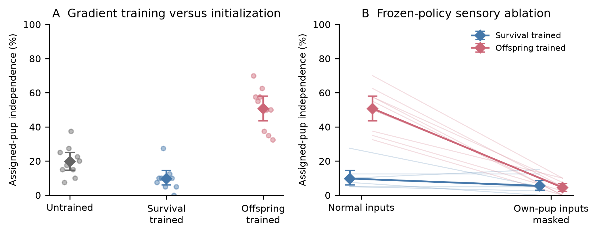

# Learning Parental Care under Crowding in Artificial Life

A two-person research project for **Deep Learning & Applied AI, Sapienza University of Rome**.

**Completed submission code:** [breakdown-mechanisms](https://github.com/ferolaa/alife-utopia/tree/breakdown-mechanisms). GitHub's default branch is currently `main`; use the linked research branch. The [verified experiment snapshot](https://github.com/ferolaa/alife-utopia/tree/878838689d5e6d6fa177b0b46864f1f7b44353f7) preserves all completed experiments.

## Research question

Can an offspring reward teach neural agents to care for their young, and how does that behavior respond to crowding-related care disruption and reduced offspring cues?

Inspired by John B. Calhoun's Universe 25, we use a **simplified, hypothesis-driven artificial-life model**, not a biological replication. Grid agents forage, age, reproduce and care for dependent pups. Controlled assays isolate specified mechanisms; population collapse is neither a required outcome nor a parameter-tuning target.

## Neural learning

[PyTorch `PolicyNet`](src/rl.py) is a small MLP: **12 sensory inputs → 12 tanh hidden neurons → 6 action logits** (234 parameters). Actions are sampled from a categorical policy. Shared-policy **REINFORCE** computes discounted returns (`gamma=0.99`), normalizes nonsingleton return batches, backpropagates the negative log-probability-weighted return loss, and updates weights with **Adam** (`lr=0.01`). It is a one-hidden-layer network, not a deeply stacked architecture.

The objectives differ only by an offspring-independence reward: **0.01 per surviving adult tick**, with an additional **1.0 when an own pup becomes independent** for the offspring objective. Ten paired training seeds share exact initial weights and matched episode worlds across objectives. Each of the 20 models was trained for **120 iterations × 500 ticks**. Subsequent evaluations freeze the policies; no evaluation learning occurs.

Worlds and initial conditions are matched across comparisons. Statistical inference uses **ten training-seed pairs**, not individual trials as independent network replicates. The same checkpoints are reused across investigations; normal neural-analysis evaluations replay Phase 1 rather than constitute an independent replication.

## Completed findings

The primary behavioral outcome is an assigned pup reaching independence, not merely moving toward a pup. Attendance, feeding, mortality and population accounting provide supporting measurements.

| Investigation | Verified finding | Evidence |
|---|---|---|
| **1. Reward learning** | Survival-only **9.75%** versus offspring reward **50.75%** independence: **+41.0 percentage points**, paired 95% CI **33.25–49.0**. | [Review](docs/PHASES_1_2_REVIEW.md), [figure](results/report_figures_v1/phase1_paired_independence.pdf) |
| **2. Controlled crowding** | With eight resource-neutral background bodies, enabling programmed care disruption reduced offspring-policy independence from **57.5% to 3.25%**. The policy × crowding × disruption contrast was **−43.75 points**. | [Review](docs/PHASES_1_2_REVIEW.md), [figure](results/report_figures_v1/phase2_independence.pdf) |
| **3. Developmental cue attenuation** | After matched childhood exposure and uncrowded transfer, programmed 30% own-pup cue attenuation reduced offspring-policy success from **57% to 42%**: **−15 points**, CI **−21 to −9.5**. | [Review](docs/PHASE3_FULL.md), [figure](results/developmental_care_v1_analysis/phase3.pdf) |
| **4. Neural controls and ablation** | Offspring-trained versus exact untrained initializations: **+31 points**, CI **21.5–39.25**. Masking only own-pup direction/need inputs: **−46.25 points**, CI **−53 to −39.25**. | [Review](docs/NEURAL_POLICY_FULL.md), [figure](results/neural_policy_v1_analysis/neural_policy.pdf) |

These results support objective-specific learning and functional reliance on offspring cues. Survival training did **not** demonstrate improved caregiving: its comparison with initialization was nonsignificant after Holm correction. Masking is an input-distribution shift, not evidence of semantic hidden representations. Persistence of developmental attenuation is programmed, not discovered neural damage or biological trauma.



Intervals are unadjusted and conditional on fixed evaluation worlds. Exact sign-flip tests assume null sign exchangeability; multiplicity adjustments apply within the documented comparison families.

## Run and verify without retraining

Use the completed branch and CPU environment. Install [uv](https://docs.astral.sh/uv/) first:

```bash
git clone --branch breakdown-mechanisms https://github.com/ferolaa/alife-utopia.git
cd alife-utopia
uv venv --python 3.12 .venv
uv pip install --python .venv/bin/python --extra-index-url https://download.pytorch.org/whl/cpu -r requirements-reproduction.txt
.venv/bin/python -m pytest -q                    # 286 tests
.venv/bin/python experiments/verify_completed.py # saved Phases 1–2
mkdir -p work
.venv/bin/python experiments/archive_neural_policy.py restore results/neural_policy_v1_archive/records.zip results/neural_policy_v1_archive/ARCHIVE.json work/neural_raw_new
.venv/bin/python experiments/verify_neural_policy.py --data work/neural_raw_new --out work/neural_verification_new.json
.venv/bin/python experiments/analyze_neural_policy.py --data work/neural_raw_new --out work/neural_figures_new
```

Every output path must be **new**. These commands verify saved evidence and regenerate the neural figure; they do not retrain or run a full experiment. Exact reproducibility was verified in the recorded Python 3.12.14 CPU environment. Dependency installation on a newly provisioned machine remains untested. See the phase-specific instructions below for all other verification and figure commands.

## Code, checkpoints and data

| Investigation | Runner | Saved evidence | Reproduction instructions |
|---|---|---|---|
| Reward comparison | [final_rewards.py](experiments/final_rewards.py) | [20 checkpoints, histories and evaluations](results/final_reward_v1/) | [Phases 1–2](docs/REPRODUCIBILITY.md) |
| Controlled crowding | [controlled_care.py](experiments/controlled_care.py) | [analysis](results/controlled_care_v1_analysis/), [lossless archive](results/controlled_care_v1_archive/) | [Phases 1–2](docs/REPRODUCIBILITY.md) |
| Developmental assay | [developmental_care.py](experiments/developmental_care.py) | [analysis](results/developmental_care_v1_analysis/), [lossless archive](results/developmental_care_v1_archive/) | [Phase 3](docs/PHASE3_REPRODUCIBILITY.md) |
| Neural controls | [neural_policy_evaluation.py](experiments/neural_policy_evaluation.py) | [analysis](results/neural_policy_v1_analysis/), [lossless archive](results/neural_policy_v1_archive/) | [Neural evaluation](docs/NEURAL_REPRODUCIBILITY.md) |

Archives preserve original bytes with SHA-256 integrity records. The original Phase 3 count-field defect is retained transparently alongside its [correction sidecar](results/developmental_care_v1_analysis/METADATA_CORRECTION.json). Earlier legacy results remain available but are not the evidence for the claims above.

## Scope and limitations

- Care is a proximity-based rule; background bodies and care disruption are explicit interventions, not a complete social model. Food replenishment does not guarantee individual access.
- Natural-colony starvation and the 120-agent training/evaluation cap limit population conclusions. Controlled assays do not establish inevitable population breakdown.
- Some pups reach independence after parent death. Phase 1/neural parent follow-up ends at pup death, so raw mortality and feeding totals have unequal exposure durations.
- Parental attendance uses post-action positions while care-blocking uses tick-start crowding. Delayed reward credit and dead-individual trajectories in individual-policy training remain limitations; the final models use episodic shared-policy training.
- Ten training seeds and fixed world panels limit generalization. No trained linear baseline establishes a need for nonlinear depth.

[Model semantics](docs/MODEL_SEMANTICS.md) provides implementation details. [Submission checklist](docs/SUBMISSION_CHECKLIST.md) separates verified course requirements from items the students must confirm. The official report and AI-use statement are separate deliverables, not this README.
